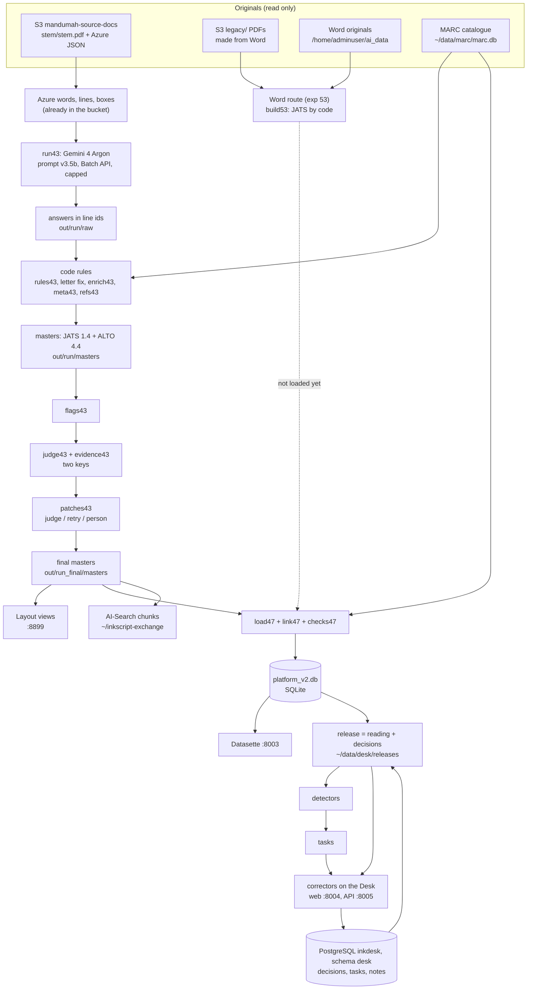

# Architecture: how the system is built

*Written 2026-10-22 from the experiment READMEs, their progress logs and the server as it stood that evening
(ports from `ss -ltnp`, the folders under `~/data`, `\dt desk.*` in `inkdesk`). The step-by-step procedures are in
[runbooks.md](runbooks.md). Where a number comes from, the source is named; numbers move, so check the source
before you quote one.*

The system turns a scanned article into a structured, faithful digital document, then links the documents into a
citation index that people correct. In the order the data flows:

1. **the pipeline**: the originals, Azure's reading, one Gemini read, code rules;
2. **the masters**: JATS + ALTO per article, then the judge and patches;
3. **the platform database**: every version of every article, the catalogue and the citation links;
4. **the Desk**: people's decisions, kept apart from the machine's reading;
5. **releases**: the reading with the decisions applied, which the screens read.

Almost all of this code lives in experiment folders (41, 43, 45–53), not in `src/`. `src/inkscript` still supplies
shared parts: `inkscript fetch`, the catalogue index (`src/inkscript/enrich/catalogue.py`), the JATS/ALTO
validators (`src/inkscript/enrich/schemas.py`) and the letter folding (`src/inkscript/text.py`). The older
ink-glyph PDF pipeline is [pipeline.md](pipeline.md).

## The flow

## The components

### Originals

- **What.** The scans with Azure's reading, the `legacy/` PDFs, the publishers' Word files and Mandumah's catalogue.
  Nothing here is ever written by us.
- **Where.**
  - `s3://mandumah-source-docs/<id>/<id>.pdf` (Azure's searchable PDF) and `<id>.json` (Azure's layout JSON):
    1,013,912 documents; `legacy/<stem>/<stem>.pdf`: 308,593 PDF-only documents; `metadata/metadata_final.xml.gz`:
    the MARC dump. Map of the bucket: [experiment 44](../experiments/44_bucket_map/README.md), whose
    `out/ids_main.txt` and `out/ids_legacy.txt` are the id lists the set builders read.
  - `s3://mandumah-qdrant-backups`: 3 Qdrant snapshots and 22 MySQL dumps (not read by any code here).
  - The Word originals: `/home/adminuser/ai_data/{journals,ai_batch2,ai_batch3}/docs`, flat folders of
    `<stem>.doc` / `.docx`, readable by `appuser` ([experiment 53](../experiments/53_word_route/README.md)).
  - The catalogue: `~/data/marc/marc.db` (SQLite, 10.2 GB, 1,558,415 records; [experiment 45](../experiments/45_marc_db/README.md)).
    The masters read their own index of the same dump, `~/.cache/inkscript/catalogue/catalogue.sqlite`.
- **Access.** S3 through the venv's `aws` with the owner's read key (`~/.aws`); fetching is `inkscript fetch`, which
  knows the main layout but not `legacy/` (experiment 53 uses `experiments/53_word_route/fetch53.sh`).

### The reader: one Gemini read per article (`run43`)

- **What.** Gemini 4 Argon looks at the page images and Azure's numbered lines and answers **in line ids only**:
  which lines make a heading, a paragraph, a note, a table cell, a verse half, a figure; the reading order; the
  metadata; the parsed references. It never retypes the text (D30). Articles go in chunks of up to 10 pages; a later
  chunk needs the previous chunk's answer, so the Batch API runs in rounds.
- **Prompt.** `prompt43.py`. Live today: **v3.5b** = v3.3's structural text word for word, plus the honorific
  ligature line, new optional keys of a cited work, and a separate `"enrich"` part written last (the 37 items of
  [experiment 51](../experiments/51_extraction_inventory/README.md)). v3.3 (hash `d6b2156150`) is the frozen exam
  prompt and stays as it was.
- **Code.** `experiments/43_rehearsal/run43.py` (Batch or Standard, `--cap`, `--max-enqueued`, `--dry-run`, resume),
  `rechunk43.py` (a chunk that hit MAX_TOKENS asked again in smaller chunks), `render43.py` (page renders checked
  against Azure's word boxes). The Gemini client, cap and price table are experiment 41's `common.py`.
- **Inputs.** A set file (`sample43.json` = set b, `sample43b.json` = set c, experiment 52's `out/sample52.json` =
  set d; set a = experiment 41's 55), the PDFs and Azure JSON it names.
- **Outputs.** `experiments/43_rehearsal/out/<run>/raw/<stem>_cAAA-BBB.json` (answer, tokens, cost),
  `batch_state.json`, `run.log`; every call is a row of `experiments/43_rehearsal/out/gemini_spend.jsonl`.
- **Cost.** About $0.008–0.010 a page on Batch at today's price; Gemini prices double on 2026-12-01. Gate 1 cost
  $0.0099 a page ([experiment 52](../experiments/52_journal_gate1/README.md)).

### Code rules (applied to every answer, before the masters)

- **What.** Everything that can be decided by code, so the model's mistakes are fixed the same way every time:
  - `rules43.py`: lines with words never left as noise, verse cuts from Azure's words, ornaments, endnotes,
    pictures drawn from ink, show-through, table cells Azure did not read (D35), guillemet halves, swapped boxes;
  - the **letter fix**: `letters43.py`, applied at run time by `lettersfix43.py` (Azure's Persian look-alike
    letters ی ک ھ ہ ڪ become the printed Arabic letters, recorded as reader fixes under D30);
  - `enrich43.py`: checks every value of v3.5's `"enrich"` part (a line id, a closed-list word or an exact
    substring of Azure's text, else dropped) and writes its JATS homes;
  - `meta43.py` (D33 metadata: honorifics, roles, Hijri years), `refs43.py` (citation fields, only if printed),
    `jats43.py` (JATS slots).
- **Tests.** `experiments/43_rehearsal/test_rules43.py`, `test_refs43.py`, `test_jats43.py`, `test_flags43.py`,
  `test_patches43.py`, `test_enrich43.py` (65 pass together, 2026-10-22).

### The masters

- **What.** One JATS 1.4 file (the article as publishers keep it) and one ALTO 4.4 file (every page, line and word
  with its box) per article, plus `<stem>.patches.json`, the D33 change log, crops and stats. Both are validated
  against the DTD and the XSD on every build.
- **Code.** `masters43.py` on experiment 41's `experiments/41_azure_structure/masters.py`. Built from saved
  answers with `pictures43.py --build` or, with the letter fix, `lettersfix43.py plain` (no calls).
- **Where.** `experiments/43_rehearsal/out/<run>/masters/`. The runs that matter today:
  `v33_300_final_lettersfix` (the first 300), `v33_300b_fix3_lettersfix` (the exam's 300), and `j0130_final`
  (gate 1's journal, a symlink into `experiments/52_journal_gate1/out/`). Older runs are kept beside them.
- **Needs.** `latex2mathml` for any article with an equation. It was missing from the repo's `.venv` on the
  morning of 2026-10-22, so that day's builds used the copy in `experiments/43_rehearsal/out/lettersfix/pylib`
  through `PYTHONPATH`. It was then installed into the repo's `.venv` (owner-approved, 2026-10-22) and added to
  `pyproject.toml`'s dependencies.

### Flags, the judge, retries and patches

- **Flags** (`flags43.py`): doubtful spots found by code, each with page, Azure line ids, severity and a reason.
  Output `out/<run>/flags.json`, `flags.txt`.
- **The judge** (`judge43.py`, `evidence43.py`): a model looks at a flagged page (scan, scan with our blocks
  numbered, our Layout page) and answers as data. It edits **only through patches** and **only with two keys**: the
  judge's confidence ≥ 0.85 and a code check from the scan and Azure. Otherwise the page goes to a one-page retry
  (`retry43.py`) or to a person. The judge never changes a word. Screenshots need Playwright: on this server
  `experiments/52_journal_gate1/out/pwvenv`, passed as `JUDGE43_PW`.
- **Patches** (`patches43.py`): edits keyed to Azure line ids, applied when the masters are built, never written
  into a master. Precedence person > judge > retry. Switched off, the master is rebuilt byte for byte as before
  (D34). The correction tool v1 (`correct43.py`) exports a person's patches from the browser.
- **Outputs.** `out/<run>_final/` (patched masters, `patches/`, `masters_before_patches/`), judge answers in
  `out/judge/answers/<model>/<run>/`, findings in `out/<run>/judge_findings.jsonl`.

### Views

- **What.** The Layout view (blocks at their printed boxes beside the scan), review pages of flagged spots,
  hand-check and correction pages, one index per run, hardest first.
- **Code.** `views43.py` (experiment 41's `views.py` with this experiment's changes), `make_index52.py` for gate 1.
- **Where.** `out/<run>/views/`, symlinked as `experiments/41_azure_structure/out/views/<run>`, which the
  `http.server` on :8899 serves.

### The Word route (experiment 53, not yet in the platform)

- **What.** The same JATS built by code from the publishers' Word files, for years with no scan. No Azure, no ALTO:
  `<stem>.pdfmap.json` maps each block to the legacy PDF. Page numbers after the first are estimates, flagged (D36).
  A Word file can be another article under the stem's name: the first-page check against the catalogue catches it.
- **Code.** `experiments/53_word_route/docx53.py`, `build53.py`; output `experiments/53_word_route/out/masters/`.

### Platform v2 (experiments 46 → 47)

- **What.** One SQLite database of entities: documents, versions (one per run of each file), blocks, notes, figures,
  table cells, corrections, citation mentions, cited-work cards, links to the catalogue, persons, institutions,
  journals, flags, judge findings, patches, reviews. Every value points at Azure's words (anchors). Every run of an
  article is kept; one version per document is shown.
- **Code.** `experiments/47_platform_v2/load47.py` (load one run; `--kind` sample | base | judged | final | exam,
  else from the run's name), `link47.py` (back references, cited-work cards, catalogue links, metrics),
  `checks47.py` (reconciliation, orphans), `diagram47.py`, `meta47.py` (Datasette metadata), `test_ids47.py`
  (stable ids across build orders and hash seeds). It imports experiment 46's parser and matchers.
- **Inputs.** The masters, each run's `flags.json`, `patches/`, `raw/`, the judge answers, the Azure JSON,
  `marc.db` (read only) and `platform.db` (experiment 46, read only, for the reconciliation).
- **Where.** `~/data/platform_v2/platform_v2.db` (1.0 GB on 2026-10-22, 780 documents: the 600, gate 1's 126, the
  54 of `v2_55`), with dated backups beside it. Platform v1, `~/data/platform/platform.db`, is kept and served;
  its file was last written on 2026-10-20, and the server's loads since then went to v2.
- **Shown versions** (2026-10-22, evening): `v33_300_final_lettersfix` 300, `v33_300b_fix3_lettersfix` 300,
  `j0130_final` 126, `v2_55` 54. A reload of the 600 with the letter fix was in progress that evening
  (`experiments/43_rehearsal/out/lettersfix/reload_progress.md`): it found 21 cited-work cards given new ids and
  was planning to redo the load from the backup.
- **Served** by Datasette on :8003 with 17 canned queries, the `fold47` plugin (Arabic folding in SQL), the schema
  diagram and the "show me the ink" page.

### The Desk (experiment 49)

- **What.** A decision editor, not a database editor. Correctors answer tasks; each answer is an append-only
  decision keyed to stable ids. A "not the same" is a decision too, so the linker cannot re-merge what a person
  split. The machine's reading is never edited: a **release** is a copy of the reading with every accepted decision
  applied.
- **Records** (PostgreSQL 16, database `inkdesk`, schema `desk`): `actors`, `tokens`, `review_rules`, `subjects`,
  `decisions`, `decision_events`, `tasks`, `task_events`, `notes`, `gold`, `releases`, `applications` (12 tables on
  2026-10-22). A trigger refuses any UPDATE of a decision except its status, and any DELETE or TRUNCATE.
- **Review model** (owner, 2026-10-21): one key; a decision's owner is its actor; only the owner or an admin may
  supersede or revert it; others leave notes.
- **Code.** `experiments/49_correction_desk/desk/`: `schema.sql`, `keys.py`, `reading.py`, `ops.py`,
  `detectors.py`, `release.py`, `api.py`, `crops.py`, `pages.py`, `cli.py`, `db.py`. Web app:
  `experiments/49_correction_desk/web/` (Next.js 14, Tailwind), proxying `/desk/api/*` to :8005 and `/views/*`
  to :8899.
- **Releases** (`release.py`): copy the reading with SQLite's backup API → apply decisions in phases (page,
  metadata, identity, back references), each in a savepoint, re-checking the constraints laid down so far →
  record an outcome per decision (applied | superseded | orphaned | conflict) → FK check and a fingerprint. Copies
  go to `~/data/desk/releases/R<time>.db`; at most 2 stay; summaries in `releases/summaries/`.
- **Detectors** (`detectors.py`): three task kinds from experiment 48 (work joined without an author, possible
  same work, byline twin). They read the newest release, else `platform_v2.db`, and make no task for a subject with
  a standing decision.
- **Config.** `desk/db.py` reads `DESK_PG` (default `dbname=inkdesk`, peer auth on the local socket),
  `DESK_SCHEMA`, `DESK_READING`, `DESK_RELEASES` from the environment.
- **Tests.** `experiments/49_correction_desk/tests/` (19 passed on 2026-10-21, in throwaway schemas
  `test_<pid>_*`); the screen walk-through `experiments/49_correction_desk/tests/p2_walkthrough.py`.

### Outputs people look at

- **Views** on :8899 (also through the Desk at `/views/…`).
- **The Desk's own pages** on :8004: the Desk screens, and static pages in `web/public/`: `/mockup/`, `/mindmap/`
  ([experiment 50](../experiments/50_mindmap/README.md)), `/inventory/` ([experiment 51](../experiments/51_extraction_inventory/README.md)),
  `/gate1/` ([experiment 52](../experiments/52_journal_gate1/README.md)). The rewrite for `/gate2/` is in
  `next.config.js`; its page was being made by experiment 54 on 2026-10-22.
- **Datasette** on :8001 (`marc.db`), :8002 (platform v1), :8003 (platform v2).
- **AI-Search chunks**: `~/inkscript-exchange/inkscript-chunks/` holds 12 exam articles' JATS, ALTO and
  `<stem>.inkscript.json` chunks made from the masters by `chunk_masters.py` and `enrich_chunks.py` (scratch code
  in that folder, not in the repo); `platform-chunks/` holds the live platform's chunks of the same articles for
  comparison. Its `README.md` gives the chunk fields and rules. The A/B on real questions waits for the owner.

## Stores and locations

| Store | Where | What | Written by |
|---|---|---|---|
| Documents | `s3://mandumah-source-docs/<id>/` | scan PDF + Azure JSON (+ HTML, Gemini title) | Mandumah; we only read |
| Legacy PDFs | `s3://mandumah-source-docs/legacy/<stem>/` | PDFs made from Word with LibreOffice | Mandumah; read only |
| Catalogue dump | `s3://mandumah-source-docs/metadata/metadata_final.xml.gz` | the MARC XML | Mandumah |
| Qdrant / MySQL backups | `s3://mandumah-qdrant-backups` | AI-Search's vectors and feedback dumps | AI-Search; not read |
| Word originals | `/home/adminuser/ai_data/{journals,ai_batch2,ai_batch3}/docs` | `.doc` / `.docx` per stem | read only |
| Catalogue database | `~/data/marc/marc.db` | 1.56M records, every field, FTS | `build45.py` (22 min) |
| Catalogue index for the masters | `~/.cache/inkscript/catalogue/catalogue.sqlite` | same dump, the masters' reader | `python -m inkscript.enrich.catalogue build` |
| Schemas, fonts | `~/.cache/inkscript/{schemas,fonts,epubcheck,view}` | JATS DTD, ALTO XSD, … | fetched on first use |
| Run folders | `experiments/43_rehearsal/out/<run>/` | `raw/` answers, `rules/`, `masters/`, `flags.json`, `views/`, `patches/` | run43 and the build scripts |
| Gate 1 | `experiments/52_journal_gate1/out/` | `fetch/`, `j0130/`, `j0130_final/`, measures | experiment 52 |
| Word route | `experiments/53_word_route/out/` | `doc/`, `docx/`, `legacy_pdf/`, `masters/` | experiment 53 |
| Page images | `experiments/43_rehearsal/out/pages/` | `<stem>_pNNN.jpg`, read by :8003's ink page and the Desk's crops | run43 |
| Spend log | `experiments/43_rehearsal/out/gemini_spend.jsonl` | one row per Gemini call; the cap is a total of it | every paid call of 43 and 52 |
| Platform v2 | `~/data/platform_v2/platform_v2.db` (+ `-wal`) | the reading | load47, link47 |
| Platform v2 backups | `~/data/platform_v2/platform_v2.before_<what>_<date>.db`, `platform_v2.db.bak-<date>-<round>` | the db before each reload | SQLite's backup API |
| Platform v2 copies | `~/data/platform_v2/gate1.db`, `dev_fields.db` | copies for gate 1 and for an agent's development | backup API |
| Platform v1 | `~/data/platform/platform.db` | experiment 46 | load46, link46 (file last written 2026-10-20) |
| Desk decisions | PostgreSQL `inkdesk`, schema `desk` (12 MB) | decisions, tasks, notes, releases | the Desk API and CLI |
| Desk releases | `~/data/desk/releases/R<time>.db`, `summaries/` | reading + decisions | `release.py` |
| Desk files | `~/data/desk/` | `api.log`, `web.log`, `crops/` (cache), `owner_token.txt`, `demo_tokens.txt` (mode 600) | the Desk |
| AI-Search exchange | `~/inkscript-exchange/` (mode 700) | chunks for AI-Search | by hand, with the AI-Search session |
| Keys | `~/inkscript/.env` (mode 600), `~/.aws/`, `~/.config/inkscript/` | Gemini key, S3 key, OpenAlex key, demo login | the owner; never in git, never printed |

`~/inkscript` and `/home/yassine` are the same place on this server: `/home/yassine` is a symlink to
`/home/appuser`, so paths stored on the laptop still resolve.

## Ports and services

Everything of ours listens on **127.0.0.1 only**. Seen with `ss -ltnp` on 2026-10-22.

| Port | Service | Serves | Started by |
|---|---|---|---|
| 8001 | Datasette, `--immutable` | `~/data/marc/marc.db` | `datasette serve` ([runbooks.md](runbooks.md#datasette-8001-8002-8003)) |
| 8002 | Datasette | platform v1, `~/data/platform/platform.db` | `datasette serve` with `metadata46.json` |
| 8003 | Datasette | platform v2, `~/data/platform_v2/platform_v2.db`, plus `/diagram/` and `/pages/` | `datasette serve` with `metadata47.json` and `plugins/` |
| 8004 | Next.js (`next start`) | the Desk screens, `/mockup/`, `/mindmap/`, `/inventory/`, `/gate1/` (and `/gate2/`), `/views/` → :8899, `/desk/api/` → :8005 | `experiments/49_correction_desk/web/restart.sh` |
| 8005 | FastAPI (uvicorn) | the Desk API under `/desk/api`, docs at `/desk/api/docs` | `python -m desk.cli serve` in experiment 49's venv |
| 8899 | `python3 -m http.server` | `experiments/41_azure_structure/out/views/` (Layout views, review, judge, proof pages) | from that folder |
| 5432 | PostgreSQL 16 (Ubuntu's, systemd, enabled) | database `inkdesk` | the system; starts at boot |

**Not ours.** The box is production for AI-Search (ai.mandumah.com). On 2026-10-22 these were also listening:
Qdrant on 6333/6334, Next servers on 3000–3002, Python services on 5000–5002 and 8808, MySQL on 3306/33060, Redis
on 6379, a web server on 80/443. Never bind those ports, never kill a process by name (AI-Search runs its own
`next-server`s), and put no heavy load on Qdrant. The ports we use were checked free with the AI-Search session
before use.

## Ids and keys

| Key | Form | Notes |
|---|---|---|
| **stem** | `0130-020-080-001` (`journal-volume-issue-seq`; `041,042` = a double issue) | = the S3 folder = AI-Search's `doc_id` = MARC 856 $u without `.pdf` (`pdf_ids.stem` in marc.db) |
| **999 $c** | integer | the catalogue's unique record key (001 is **not** unique); = AI-Search's `pdf_id` |
| `rec` | integer | marc.db's own key: a record's order in the XML |
| publication | `W<999$c>`, or `WS<stem>` when uncatalogued | a link to a catalogued-only item survives the day it is scanned |
| person / institution / cited work | `A` / `I` / `C` + 9 Crockford base-32 characters | a hash of the natural key (an authority id, a corporate authority, a founding mention); registered in `id_registry`; a retired id goes to `merged_ids` |
| journal | `J<code>` | the catalogue's journal code |
| version | `V:<stem>@<run>` | surrogate keys are 53-bit hashes of natural keys (`common47.STABLE_PK`), so a rebuild gives the same ids |
| anchor | `<stem>\|p<page>\|w<first>-<last>` | Azure's own word numbering, which no run renumbers; figures use a box form |
| citation mention | `<stem>\|p<page>\|w<first>-<last>\|<n>` | unique per version; the same citation has the same id in every run |
| Azure line | `P:N` | the label flags, patches and judge targets use |
| JATS / ALTO ids | `p<page>b<n>` blocks, `p3b6l2` lines, `p<page>w<nnnn>` words, `fn-p15-13` notes | per run |
| patch | `j-…` judge, `h-…` person, `r-…` retry | keyed to Azure line ids |
| Desk subject | `work:C…`, `person:A…`, `mention:<mention id>`, `authority:<id>`, `byline:<anchor key>` (or `<stem>\|<block>\|<pos>\|<script>` when the byline has no ink anchor), `article:<stem>`; `pubfield:W…\|field` and `line:…` reserved | a decision whose key vanishes is **orphaned** and its owner gets a re-anchor task |
| Desk release | `R<yyyymmdd>T<hhmmss>` | e.g. `R20261022T231143` |
| AI-Search chunk | `<doc_id>_chunk_NNN` | as AI-Search's own chunker names them |

## Principles

- **The text is the print** (D30). The digital text is exactly what is printed. A reader's misreading (Azure saw a
  letter that is not there) is fixed and recorded; an author's or printer's misprint stays, with a flagged
  correction beside it. Gemini types no text: everything it gives is a line id, a closed-list word or an exact
  substring of Azure's text.
- **Metadata is corrected, the printed form kept** (D33). Title, names, affiliations, keywords, dates, journal,
  volume, issue: the corrected form in the main slot, the printed form beside it, every change logged with its
  source and reason. The abstract and body stay as printed.
- **A person's correction is a patch** (D34), never an edit to a master. Patches off = the master exactly.
- **A table cell Azure did not read takes the model's reading, inside the cell, marked as added** (D35).
- **Word-route pages are estimates, flagged** (D36).
- **Decisions are append-only.** The Desk never edits the reading; a later decision supersedes an earlier one and
  both stay. "No" is stored.
- **Nothing is overwritten.** A rebuild goes into a new run folder; the platform keeps every version; a reload is
  preceded by a dated backup; releases are copies.
- **Private data stays private.** The catalogue, the platform databases, the documents and the Desk are Mandumah's
  private data: on 127.0.0.1 only, never on a public link, never in git (`experiments/*/out/` is gitignored).
  Static pages in the Desk's `web/public/` hold Mandumah titles and must be kept out of commits.
- **Money is capped.** Every paid run has the owner's cap, written as an absolute total of the spend log.

## Where the design docs and the server differ

- Experiment 49's DESIGN §11 planned a user-level PostgreSQL in `~/pg` on port 5433. The server has Ubuntu's
  PostgreSQL 16 on 5432 instead, and `appuser` cannot create databases (`rolcreatedb` false), so the tests use
  schemas inside `inkdesk`.
- Experiment 50's README says the mind map is served from experiment 49's `out/site/`; it is now in
  `web/public/mindmap/`.
- Experiment 47's README writes its paths under `/home/yassine`; on this server that is a symlink to
  `/home/appuser`.
